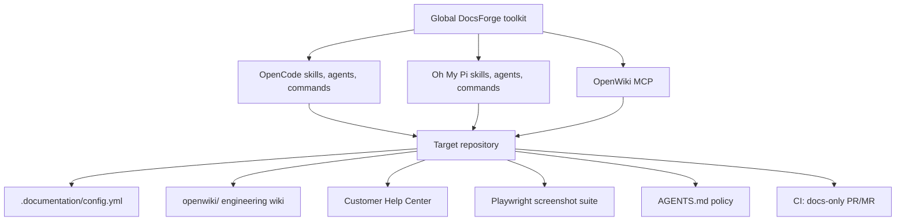

# DocsForge

**Universal documentation infrastructure for coding agents.**

Install once. Document every repository. Keep engineering knowledge and
customer help in sync with the code that actually ships.

[](LICENSE)
[](https://saidrassai.github.io/docsforge/)
[](https://github.com/saidrassai/docsforge/actions/workflows/ci.yml)
[](https://nodejs.org)
[](https://opencode.ai)
[](https://github.com/can1357/oh-my-pi)
[](https://github.com/langchain-ai/openwiki)
[](https://playwright.dev)

---

DocsForge is a globally installed documentation toolkit for **OpenCode** and
**Oh My Pi (OMP)**. It gives every repository the same documentation workflow
without forcing the same documentation framework on every project.

It deliberately separates two domains that usually get mixed together:

| Domain | Audience | Engine | Location |
| --- | --- | --- | --- |
| **Codebase knowledge** | Engineers and coding agents | [OpenWiki](https://github.com/langchain-ai/openwiki) | `<repo>/openwiki/` |
| **Customer documentation** | Customers, admins, operators | Project-selected Help Center | `<repo>/docs/...` or existing docs root |
| **Screenshots** | End users | [Playwright](https://playwright.dev) | `<repo>/docs/assets/screenshots/` |

Internal architecture never leaks into the public Help Center. One project's
wiki is never used as evidence for another project.

---

## Why DocsForge

Most documentation tooling assumes one project, one framework, and one
audience. Real SaaS work has several repositories, several stacks, and at least
two audiences.

DocsForge provides:

- **One global installation** for OpenCode and OMP skills, agents, and slash
  commands.
- **Project-local documentation** with its own config, wiki, guides,
  screenshots, and Git history.
- **Source-grounded engineering docs** through OpenWiki Claims and versioned
  source evidence — not generated prose from memory.
- **Task-based customer guides** verified against real UI labels, permissions,
  navigation, and results.
- **Real screenshots** from Playwright, never fabricated mockups.
- **Framework adapters** for Next.js/Fumadocs, React, Python/MkDocs, static
  sites, existing Help Centers, and projects without a UI.
- **Incremental sync** that maps a Git diff to the pages and screenshots that
  actually changed.
- **Independent audits** that report evidence-backed findings before rewriting.
- **Docs-only CI** that opens a PR/MR, never auto-merges, and never edits
  application source.

---

## How it works



### The lifecycle

1. **Inspect** — identify the Git root, stack, product type, UI, existing docs,
   docs framework, E2E tooling, and CI host.
2. **Initialize** — create only the infrastructure the project needs.
3. **Document** — let OpenWiki build source-grounded engineering knowledge and
   the writer build task-based customer guides.
4. **Capture** — use Playwright against the running app with synthetic data.
5. **Sync** — after implementation changes, update only impacted pages and
   screenshots.
6. **Audit** — independently compare docs with code, runtime, permissions, and
   current screenshots.
7. **Automate** — run scheduled docs-only CI with human review.

---

## Requirements

| Requirement | Notes |
| --- | --- |
| Node.js **≥ 22.22.0** | Required by OpenWiki |
| Git | DocsForge refuses to write outside a Git root |
| OpenCode 2.x and/or Oh My Pi 18.x | At least one host |
| npm or pnpm | For OpenWiki and project dependencies |
| Playwright | Only when the project has a browser UI |

Windows notes:

- Use **npm** or **pnpm** for OpenWiki, not Bun, because of native dependency
  compatibility.
- PowerShell wrappers are provided. No administrator rights or symlinks are
  required.
- The canonical install directory is `~/.documentation-toolkit` on every
  platform, including Windows.

---

## Install

### 1. Clone the toolkit

```sh
git clone https://github.com/saidrassai/docsforge.git ~/.documentation-toolkit
```

PowerShell:

```powershell
git clone https://github.com/saidrassai/docsforge.git "$HOME\.documentation-toolkit"
```

### 2. Install into your agents

```sh
node ~/.documentation-toolkit/scripts/docs-toolkit.mjs install --host all
```

PowerShell:

```powershell
node "$HOME\.documentation-toolkit\scripts\docs-toolkit.mjs" install --host all
```

This installs:

- skills into `~/.config/opencode/skills/` and `~/.omp/agent/skills/`
- agents into `~/.config/opencode/agents/` and `~/.omp/agent/agents/`
- commands into `~/.config/opencode/commands/` and `~/.omp/agent/commands/`

Copies are used instead of symlinks so the same install works on Windows
without Developer Mode.

### 3. Install OpenWiki and host integrations

```sh
npm install -g openwiki

openwiki integrations install opencode
openwiki integrations install omp
```

### 4. Verify

```sh
node ~/.documentation-toolkit/scripts/docs-toolkit.mjs status
node ~/.documentation-toolkit/scripts/docs-toolkit.mjs verify
node ~/.documentation-toolkit/scripts/verify-hosts.mjs
node ~/.documentation-toolkit/scripts/self-test.mjs
```

`verify-hosts` asks OpenCode and OMP for their live catalogs and confirms the
skills, commands, agents, and OpenWiki MCP integration.

If Windows blocks local scripts:

```powershell
powershell -NoProfile -ExecutionPolicy Bypass -File .\scripts\status.ps1
```

---

## Quick start in a repository

```text
/docs-init
```

Then:

```text
/docs-code
/docs-user "your first primary journey"
/docs-screenshots "that journey"
/docs-audit
```

Or run the deterministic bootstrap directly:

```sh
cd ~/projects/acme-saas
git rev-parse --show-toplevel

node ~/.documentation-toolkit/scripts/init-project.mjs --root . --dry-run
node ~/.documentation-toolkit/scripts/init-project.mjs --root .
```

`/docs-init` creates only infrastructure:

```text
.documentation/config.yml
.documentation/state.json
.documentation/README.md
.documentation/user-docs.md
.documentation/templates/user-guide.md
.documentation/audit/
.documentation/screenshots/
.documentation/toolkit/            # project-local validation scripts for CI
openwiki/INSTRUCTIONS.md
.openwikiignore
<user-docs content directory>/
docs/assets/screenshots/
playwright.docs.config.ts          # only when a browser UI exists
AGENTS.md                          # managed block merged, existing text kept
.github/workflows/docs-*.yml       # only for GitHub
```

It does **not** invent architecture, guides, or screenshots. Content comes
from verified source and the running product.

---

## Commands

| Command | What it does |
| --- | --- |
| `/docs-init` | Initialize docs infrastructure for the current Git repository |
| `/docs-sync` | Update only docs affected by current implementation changes |
| `/docs-audit` | Full, engineering, customer, or screenshot audit |
| `/docs-code` | Work only on the OpenWiki engineering knowledge base |
| `/docs-user` | Work only on customer-facing Help Center guides |
| `/docs-screenshots` | Capture or regenerate real application screenshots |

Examples:

```text
/docs-sync origin/main
/docs-audit engineering
/docs-audit customer
/docs-audit screenshots
/docs-code billing permissions
/docs-user "invite a member"
/docs-screenshots "invite member"
```

---

## Skills

| Skill | Responsibility |
| --- | --- |
| `docs-orchestrator` | Inspect the repo, assess health, choose the smallest correct operation |
| `codebase-documentation` | OpenWiki lifecycle, architecture, data, APIs, security, ops, ADRs, Claims |
| `user-documentation` | Audience research, task guides, labels, permissions, Help Center adapters |
| `documentation-screenshots` | Playwright captures, auth, fixtures, inventory, targeted regeneration |
| `documentation-audit` | Independent evidence-based review of both domains and screenshots |
| `documentation-bootstrap` | Global install/verify/upgrade/uninstall and project bootstrap |

Skills use the portable `SKILL.md` format and are installed into both hosts.

---

## Agents

| Agent | Purpose |
| --- | --- |
| `documentation-architect` | Plan and maintain engineering docs and documentation infrastructure |
| `documentation-writer` | Write customer guides from verified product behavior |
| `documentation-auditor` | Read-only audit with evidence and severity |
| `screenshot-specialist` | Build deterministic Playwright screenshot workflows |

---

## Framework adapters

DocsForge does not force one docs framework on every project.

| Adapter | Use when |
| --- | --- |
| `nextjs-fumadocs` | Next.js application; Fumadocs is the preferred Help Center |
| `react` | Docusaurus, Nextra, Starlight, or VitePress |
| `python-mkdocs` | Python API, CLI, library, or standalone docs |
| `nodejs` | Node API/CLI/library reference docs |
| `static-site` | Independent documentation product |
| `existing-docs` | Preserve and improve a working Help Center |
| `none` | No customer UI; no unnecessary Help Center or browser harness |

Selection order: preserve an existing Help Center → Next.js/Fumadocs → other
React tooling → Python/MkDocs → static site → no UI.

Fumadocs, MkDocs, Docusaurus, and similar tools are **project dependencies**,
never global installs.

---

## Project configuration

Every repository gets `.documentation/config.yml`:

```yaml
version: 1

project:
  name: acme-saas
  type: saas

codebase:
  enabled: true
  engine: openwiki
  output: openwiki/

user_docs:
  enabled: true
  framework: fumadocs
  audience:
    - workspace owner/admin
  content_directory: content/docs

screenshots:
  enabled: true
  engine: playwright
  source: application
  demo_data: synthetic
  config: playwright.docs.config.ts
  content_directory: docs/assets/screenshots
  inventory: .documentation/screenshots/inventory.yml

automation:
  agent_completion_sync: true
  daily_ci_sync: true
  automatic_merge: false
  ci_provider: github
  docs_only_paths:
    - openwiki/
    - content/docs/
    - docs/assets/screenshots/
    - .documentation/
    - AGENTS.md

security:
  internal_docs_public: false
  production_data_in_screenshots: false
  secrets_in_docs: false
```

Validate it:

```sh
node ~/.documentation-toolkit/scripts/validate-config.mjs --root . --json
```

The validator rejects paths that escape the repository and warns about unsafe
security settings.

---

## How sync stays small

`/docs-sync` does not regenerate everything. It runs:

```sh
node ~/.documentation-toolkit/scripts/docs-impact.mjs --root . --base <ref> --json
```

The impact map reports:

- changed files and categories (`ui`, `api`, `database`, `auth`, `jobs`,
  `config`, `integrations`, `tests`);
- impacted routes;
- impacted OpenWiki pages;
- impacted customer guides;
- impacted screenshot inventory entries.

Only those pages and captures are updated.

Internal refactors with no behavior, contract, schema, security, or workflow
change produce **no public documentation changes**. DocsForge reports that
explicitly instead of churning pages.

---

## Engineering documentation with OpenWiki

OpenWiki is the primary codebase knowledge engine.

DocsForge teaches agents to:

- initialize a wiki for the current repository only;
- read relevant existing knowledge instead of preloading everything;
- use OpenWiki’s resumable page-job lifecycle;
- preserve source evidence such as `repo://src/auth.ts#L20-L48`;
- reconcile stale Claims by rechecking current source;
- update only impacted pages;
- avoid speculative architecture and invented relationships;
- keep runbooks and internal knowledge out of the public Help Center.

Generated output lives in `<repo>/openwiki/`, including versioned Claims under
`openwiki/.claims/`.

For scheduled runs, OpenWiki uses its standalone CLI and provider credentials.
Those credentials are separate from interactive agent sessions.

---

## Screenshots

Screenshots are evidence from the running product, not illustrations.

The generated docs-only Playwright config:

- lives beside the app's own E2E/visual-regression config;
- uses a fixed viewport, locale, timezone, theme, and reduced motion;
- authenticates with a dedicated test user via `storageState`;
- uses synthetic demo data;
- asserts the expected UI state before capturing;
- writes to `docs/assets/screenshots/`;
- records every image in `.documentation/screenshots/inventory.yml`;
- regenerates only affected images.

Never use AI-generated mockups, production customer data, or brittle CSS
selectors.

---

## CI automation

`/docs-init` writes a workflow only for the repository's existing CI host:

| Host | Output |
| --- | --- |
| GitHub | `.github/workflows/docs-check.yml`, `docs-sync.yml` |
| GitLab | `.documentation/ci/openwiki-update.gitlab-ci.yml` + include |
| Bitbucket | Staged custom pipeline |
| None | Guidance only; no second CI platform |

Scheduled sync:

- runs daily and on manual dispatch;
- pins actions and OpenWiki;
- uses least-privilege permissions;
- changes only approved documentation paths;
- opens a docs-only PR/MR;
- never auto-merges;
- fails visibly.

Required GitHub secrets/variables depend on the provider. The default example
uses `OPENROUTER_API_KEY`; set `OPENWIKI_PROVIDER` and `OPENWIKI_MODEL_ID` as
repository variables if needed.

An optional `docs-screenshots.yml` template exists for projects with a
deterministic screenshot suite and CI-startable app.

---

## Safety model

DocsForge is designed to be safe to install globally:

- It backs up host configuration before overwriting managed files.
- It skips unmanaged conflicts unless `--force` is used.
- It never overwrites user content files such as an existing wiki, guide
  inventory, or screenshot specs.
- It validates config paths against the repository root.
- It keeps public and internal documentation physically separate.
- It refuses to write outside a Git root.
- It never commits, pushes, publishes, deploys, or merges.
- It records every managed file in `state/install-manifest.json` for exact
  uninstall.

Audit checks include:

- public docs referencing `openwiki/`;
- possible secrets and tokens;
- missing or stale screenshots;
- broken internal links;
- invalid frontmatter;
- missing OpenWiki index/quickstart;
- stale OpenWiki updates;
- docs-only CI path restrictions;
- auto-merge configuration.

---

## Verification

The toolkit was installed and verified against:

- Ubuntu 26.04.1 LTS
- Node.js 24.22.2
- OpenCode 2.1.4
- Oh My Pi 18.15.0
- OpenWiki 0.9.0
- Playwright 1.65

Live checks:

| Check | Result |
| --- | --- |
| OpenCode skill catalog | PASS — all 6 |
| OpenCode command catalog | PASS — all 6 |
| OpenCode agent catalog | PASS — all 4 |
| OMP skill catalog | PASS — all 6 |
| OMP command catalog | PASS — all 6 |
| OpenWiki MCP | PASS — both hosts |
| OpenWiki lifecycle start | PASS |
| Playwright real capture | PASS — 1440×900 PNG from a local app |
| Self-test | PASS — 9/9 |
| Uninstall/restore | PASS — isolated fake-home test |

See [VERIFICATION.md](VERIFICATION.md) for the full acceptance record,
including what was not exercised.

---

## Documentation site

The project documentation is built with MkDocs Material and deployed to GitHub
Pages:

**<https://saidrassai.github.io/docsforge/>**

Run it locally:

```sh
python -m venv .venv-docs
. .venv-docs/bin/activate
pip install -r requirements-docs.txt
mkdocs serve
```

Build with strict link validation:

```sh
mkdocs build --strict
```

The source lives in `docs/`, with navigation in `mkdocs.yml`.

---

## Development

The repository is the source of truth. The installed copy lives at
`~/.documentation-toolkit`.

```sh
git clone https://github.com/saidrassai/docsforge.git
cd docsforge

node scripts/self-test.mjs
node scripts/docs-toolkit.mjs verify
```

After editing canonical skills, agents, or commands:

```sh
node scripts/docs-toolkit.mjs sync --host all
node scripts/docs-toolkit.mjs verify
```

Repository layout:

```text
skills/       canonical Agent Skills
agents/       prompts + host-specific frontmatter definitions
commands/     canonical slash-command bodies
adapters/     framework selection and setup guidance
scripts/      cross-platform Node automation + wrappers
templates/    project, OpenWiki, codebase, user, Playwright, CI
schemas/      config and frontmatter schemas
examples/     worked examples
docs/         DocsForge documentation site (MkDocs Material)
mkdocs.yml    Docs site navigation and theme
state/        install manifest (generated locally)
backups/      host configuration backups (generated locally)
```

Generated `state/install-manifest.json` and `backups/` are intentionally
gitignored.

---

## Troubleshooting

| Symptom | Check |
| --- | --- |
| Skill missing in OpenCode | `~/.config/opencode/skills/<id>/SKILL.md` and `description` |
| Skill missing in OMP | `~/.omp/agent/skills/<id>/SKILL.md`; name must match directory |
| Command missing | Check host `commands/` directories; run `sync` |
| OpenWiki MCP missing | `openwiki integrations list`; inspect host MCP config |
| OpenWiki generation fails in CI | Provider credentials are separate from agent sessions |
| Screenshot auth fails | Dedicated test user and env vars, not production credentials |
| Config invalid | `node scripts/validate-config.mjs --root .` |
| Windows script blocked | `-ExecutionPolicy Bypass` or `Unblock-File` |

Logs:

- OpenCode: `~/.local/share/opencode/log/opencode.log`
- OMP: `~/.omp/logs/`

Do not delete databases or session state while diagnosing.

---

## Uninstall

```sh
node ~/.documentation-toolkit/scripts/docs-toolkit.mjs uninstall --host all
```

Remove OpenWiki too:

```sh
node ~/.documentation-toolkit/scripts/docs-toolkit.mjs uninstall --host all \
  --remove-openwiki --yes
```

Delete the toolkit itself:

```sh
node ~/.documentation-toolkit/scripts/docs-toolkit.mjs uninstall --host all \
  --purge --yes
```

Project documentation is never deleted by uninstall.

---

## Contributing

Issues and pull requests are welcome.

Please:

1. Keep skills, agents, and commands canonical in this repository.
2. Run `node scripts/self-test.mjs` before opening a PR.
3. Keep public and internal documentation boundaries intact.
4. Never add fabricated screenshots, product behavior, or permissions.
5. Preserve unrelated configuration and user content.

See [CONTRIBUTING.md](CONTRIBUTING.md) and [SECURITY.md](SECURITY.md).

---

## License

MIT. See [LICENSE](LICENSE).

DocsForge builds on excellent open-source work:

- [OpenWiki](https://github.com/langchain-ai/openwiki) — MIT
- [Playwright](https://playwright.dev) — Apache-2.0
- [OpenCode](https://opencode.ai) — open source
- [Oh My Pi](https://github.com/can1357/oh-my-pi) — MIT
- [Fumadocs](https://www.fumadocs.dev) — MIT
- [MkDocs](https://www.mkdocs.org) and [Material for MkDocs](https://squidfunk.github.io/mkdocs-material/) — permissive open source

OpenWiki telemetry is enabled by default. Disable it with
`OPENWIKI_TELEMETRY_DISABLED=1` or `DO_NOT_TRACK=1`.
