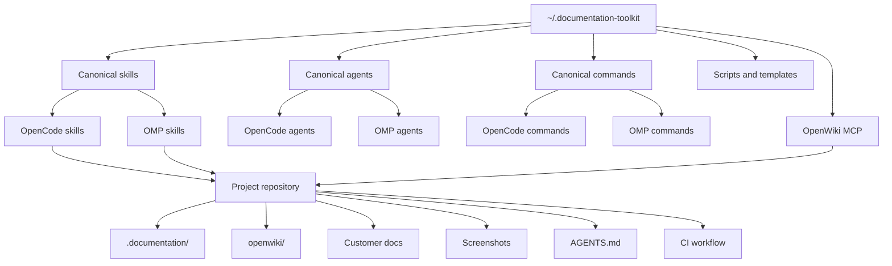

# Architecture

DocsForge has three layers: a global toolkit, host adapters, and project-local
documentation.



## Global toolkit

The canonical source lives at `~/.documentation-toolkit`:

```text
skills/       portable Agent Skills
agents/       prompts + host-specific frontmatter definitions
commands/     slash-command bodies
adapters/     framework selection guidance
scripts/      cross-platform Node automation
templates/    project, OpenWiki, codebase, user, Playwright, CI
schemas/      config and frontmatter schemas
state/        install manifest
backups/      host configuration backups
```

The toolkit contains **no project documentation**.

## Host adapters

DocsForge generates compatible copies for each host:

| Host | Skills | Agents | Commands |
| --- | --- | --- | --- |
| OpenCode | `~/.config/opencode/skills/` | `~/.config/opencode/agents/` | `~/.config/opencode/commands/` |
| Oh My Pi | `~/.omp/agent/skills/` | `~/.omp/agent/agents/` | `~/.omp/agent/commands/` |

Skills are portable `SKILL.md` files. OMP validates names strictly, so the
directory name and frontmatter `name` must match.

Agents and commands use host-specific frontmatter. The prompt body is shared
from one canonical source.

Copies are used instead of symlinks so the toolkit works on Windows without
Developer Mode.

## Project layer

Each repository owns:

```text
.documentation/
  config.yml
  state.json
  audit/
  screenshots/
  adapters/
  toolkit/            # local validation scripts for CI
openwiki/
  INSTRUCTIONS.md
  ...generated wiki and Claims
docs/
  ...customer guides and screenshot assets
AGENTS.md             # managed policy block
.github/workflows/    # docs-only automation
```

Nothing in this layer is shared with another repository.

## Source-of-truth rules

1. Skills exist only in the toolkit's `skills/` directory.
2. Host copies are generated artifacts.
3. Agents use one shared prompt per role.
4. Commands use one shared body.
5. Every project owns its config, wiki, guides, screenshots, and CI.
6. OpenWiki content is engineering knowledge, never a public Help Center.

## OpenWiki integration

OpenWiki is installed globally and integrated into both hosts:

```sh
npm install -g openwiki
openwiki integrations install opencode
openwiki integrations install omp
```

The integration provides:

- an OpenWiki skill;
- an MCP server;
- authenticated host-agent generation;
- a standalone CLI for scheduled runs.

The MCP lifecycle is:

```text
openwiki_begin
  → openwiki_submit_plan
  → openwiki_next_page
  → openwiki_submit_page
  → …
  → openwiki_finish
```

Claims track the source evidence behind material statements. When evidence
changes, the next update identifies the affected facts.

## Validation layer

| Script | Role |
| --- | --- |
| `detect-stack.mjs` | Repository and stack inventory |
| `init-project.mjs` | Safe project bootstrap |
| `validate-config.mjs` | Config contract validation |
| `audit-project.mjs` | Deterministic engineering/customer/screenshot audit |
| `docs-impact.mjs` | Git diff → impacted pages and captures |
| `verify-hosts.mjs` | Live host catalog verification |
| `self-test.mjs` | Isolated end-to-end test |

The validation layer is deliberately dependency-free Node.js.
