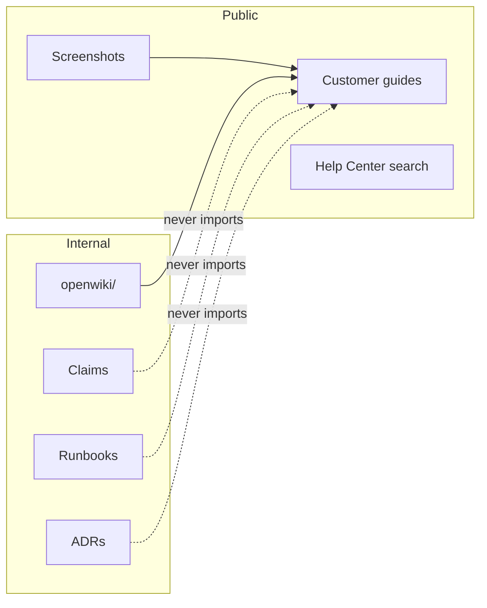

# Two documentation domains

DocsForge treats engineering documentation and customer documentation as two
separate products with different audiences, evidence, and safety rules.

| | Codebase documentation | Customer documentation |
| --- | --- | --- |
| **Audience** | Engineers, coding agents, operators | Customers, admins, operators |
| **Question** | How does the system work? | How do I complete this task? |
| **Engine** | OpenWiki | Project-selected Help Center |
| **Location** | `<repo>/openwiki/` | `<repo>/docs/...` or existing docs root |
| **Evidence** | Source, tests, migrations, config, runtime | Running UI, authorization code, real screenshots |
| **Visibility** | Internal | Public unless the product is internal |
| **Change trigger** | Architecture, contracts, schema, security, operations | User-visible behavior, labels, permissions, navigation, results |

## Codebase documentation

Codebase docs answer questions such as:

- What are the system boundaries and runtime entrypoints?
- Which module owns this behavior?
- What are the database relationships and tenant boundaries?
- What does this API accept, return, and reject?
- Who can perform this action, and where is it enforced?
- What happens when an external service fails?
- How is this deployed, rolled back, or restored?
- Why was this architectural decision made?

This is **not** a customer Help Center. It contains source references, Claims,
runbooks, and internal implementation detail.

## Customer documentation

Customer docs answer questions such as:

- What does this feature do?
- Who can use it?
- What do I need before I start?
- Where do I find it?
- What do I click?
- What do I enter?
- What should I see when it works?
- What do I do when it fails?

Customer docs use the product's vocabulary, exact UI labels, and real
screenshots. They do not explain internal architecture, database tables,
feature flags, prompts, or operational procedures.

## The boundary

Rules:

- Never import `openwiki/` into a public docs build.
- Never link a public route directly to an internal directory.
- Never copy a runbook or architecture page into the Help Center.
- Never use an internal screenshot in public documentation.
- Never use one repository's wiki as evidence for another repository.

## When a change affects both

A new user-facing feature often changes both domains:

1. Engineering docs gain the API, schema, permission, and module behavior.
2. Customer docs gain the task guide, prerequisites, and screenshots.
3. The audit checks both independently.

A purely internal refactor changes neither public guide nor screenshot. It may
change engineering docs if architecture, contracts, security, or operations
changed.

## Why not one knowledge base?

A single knowledge base tends to fail in one of two directions:

- internal detail leaks into public docs;
- public wording replaces precise engineering evidence.

Separate domains keep each audience's quality bar intact. DocsForge connects
them through the change workflow, not by merging their content.
