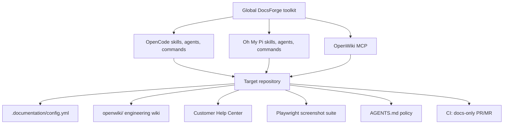

# DocsForge

<div class="hero" markdown>

**Universal documentation infrastructure for coding agents.**

Install once. Document every repository. Keep engineering knowledge and
customer help in sync with the code that actually ships.

<div class="badge-row" markdown>
[](https://github.com/saidrassai/docsforge/blob/main/LICENSE)
[](https://github.com/saidrassai/docsforge/actions/workflows/ci.yml)
[](https://nodejs.org)
</div>

</div>

DocsForge is a globally installed documentation toolkit for **OpenCode** and
**Oh My Pi (OMP)**. It gives every repository the same documentation workflow
without forcing the same documentation framework on every project.

It deliberately separates two domains that usually get mixed together.

## Two domains, one system

<div class="grid cards" markdown>

-   :material-code-braces: **Codebase knowledge**

    ---

    Source-grounded architecture, schema, APIs, permissions, jobs, operations,
    security, and ADRs for engineers and coding agents.

    Built with [OpenWiki](https://github.com/langchain-ai/openwiki) in
    `<repo>/openwiki/`.

-   :material-account-group: **Customer documentation**

    ---

    Task-based tutorials, navigation paths, prerequisites, permissions,
    expected results, and troubleshooting for the people who use the product.

    Lives in the project's chosen Help Center framework.

-   :material-camera: **Real screenshots**

    ---

    Playwright captures from the running application, with synthetic demo data,
    stable locators, and targeted regeneration. Never fabricated mockups.

-   :material-shield-lock: **Separated by design**

    ---

    Internal engineering knowledge never leaks into the public Help Center.
    One project's wiki is never used as evidence for another project.

</div>

## Why DocsForge

Most documentation tooling assumes one project, one framework, and one
audience. Real SaaS work has several repositories, several stacks, and at least
two audiences.

DocsForge provides:

- **One global installation** for OpenCode and OMP skills, agents, and slash
  commands.
- **Project-local documentation** with its own config, wiki, guides,
  screenshots, and Git history.
- **Source-grounded engineering docs** through OpenWiki Claims and versioned
  source evidence — not generated prose from memory.
- **Task-based customer guides** verified against real UI labels, permissions,
  navigation, and results.
- **Framework adapters** for Next.js/Fumadocs, React, Python/MkDocs, static
  sites, existing Help Centers, and projects without a UI.
- **Incremental sync** that maps a Git diff to the pages and screenshots that
  actually changed.
- **Independent audits** that report evidence-backed findings before rewriting.
- **Docs-only CI** that opens a PR/MR, never auto-merges, and never edits
  application source.

## How it works



## Install

```sh
git clone https://github.com/saidrassai/docsforge.git ~/.documentation-toolkit
node ~/.documentation-toolkit/scripts/docs-toolkit.mjs install --host all
```

Then install OpenWiki and its host integrations:

```sh
npm install -g openwiki
openwiki integrations install opencode
openwiki integrations install omp
```

Verify:

```sh
node ~/.documentation-toolkit/scripts/verify-hosts.mjs
node ~/.documentation-toolkit/scripts/self-test.mjs
```

[Read the full installation guide](getting-started/installation.md){ .md-button .md-button--primary }
[Quick start in a repository](getting-started/quickstart.md){ .md-button }

## Commands

| Command | What it does |
| --- | --- |
| `/docs-init` | Initialize docs infrastructure for the current Git repository |
| `/docs-sync` | Update only docs affected by current implementation changes |
| `/docs-audit` | Full, engineering, customer, or screenshot audit |
| `/docs-code` | Work only on the OpenWiki engineering knowledge base |
| `/docs-user` | Work only on customer-facing Help Center guides |
| `/docs-screenshots` | Capture or regenerate real application screenshots |

## Safety first

DocsForge backs up host configuration before overwriting managed files, skips
unmanaged conflicts unless forced, validates project paths against the Git
root, and never commits, pushes, publishes, deploys, or merges.

[Read the security model](security.md){ .md-button }
