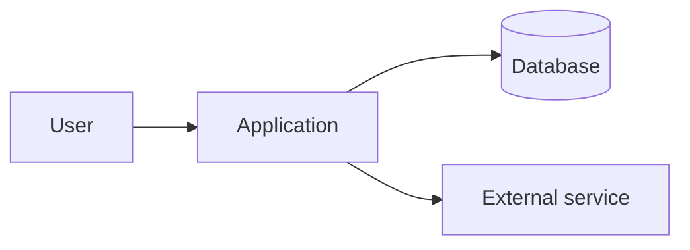
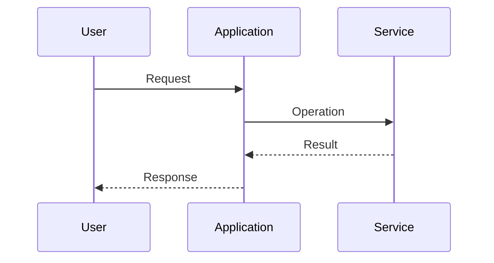

# Architecture: <system>

## Purpose

<What the system does and for whom.>

## Context

## Containers / modules

| Module | Responsibility | Depends on | Owns data |
| --- | --- | --- | --- |
| <module> | <responsibility> | <modules> | <tables> |

## Runtime flows

### <Flow name>

## Invariants

- <Invariant and source reference.>

## Decisions

- [ADR-0001](adr/0001-<slug>.md)

## Evidence

- `<path#Lx-Ly>`
- `<test path>`
- `<migration path>`
