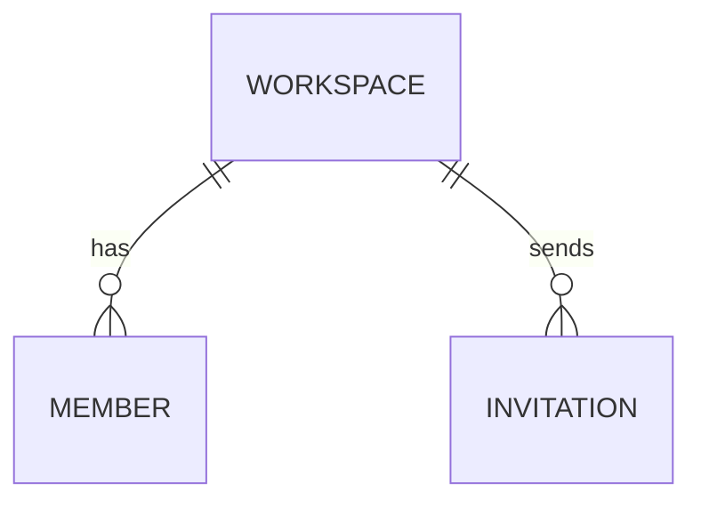

# Data model

## Engines and connections

- Primary: <engine>, configured by `<path>`.
- Replicas/caches: <engine>.
- Tenant boundary: <rule and source>.

## Entities

### `<table>`

| Column | Type | Null | Default | Notes |
| --- | --- | --- | --- | --- |
| `id` | <type> | no | <default> | <notes> |

- Primary key: <columns>
- Unique: <constraints>
- Indexes: <indexes and purpose>
- Foreign keys: <references and cascade behavior>
- Retention: <policy and job>

## Relationships

## Migrations

- Tool: <tool>
- Location: `<path>`
- Rollback: <procedure>
- Destructive migrations: <policy>

## Evidence

- `<migration path>`
- `<schema path>`
- `<test path>`
